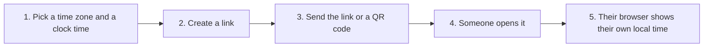
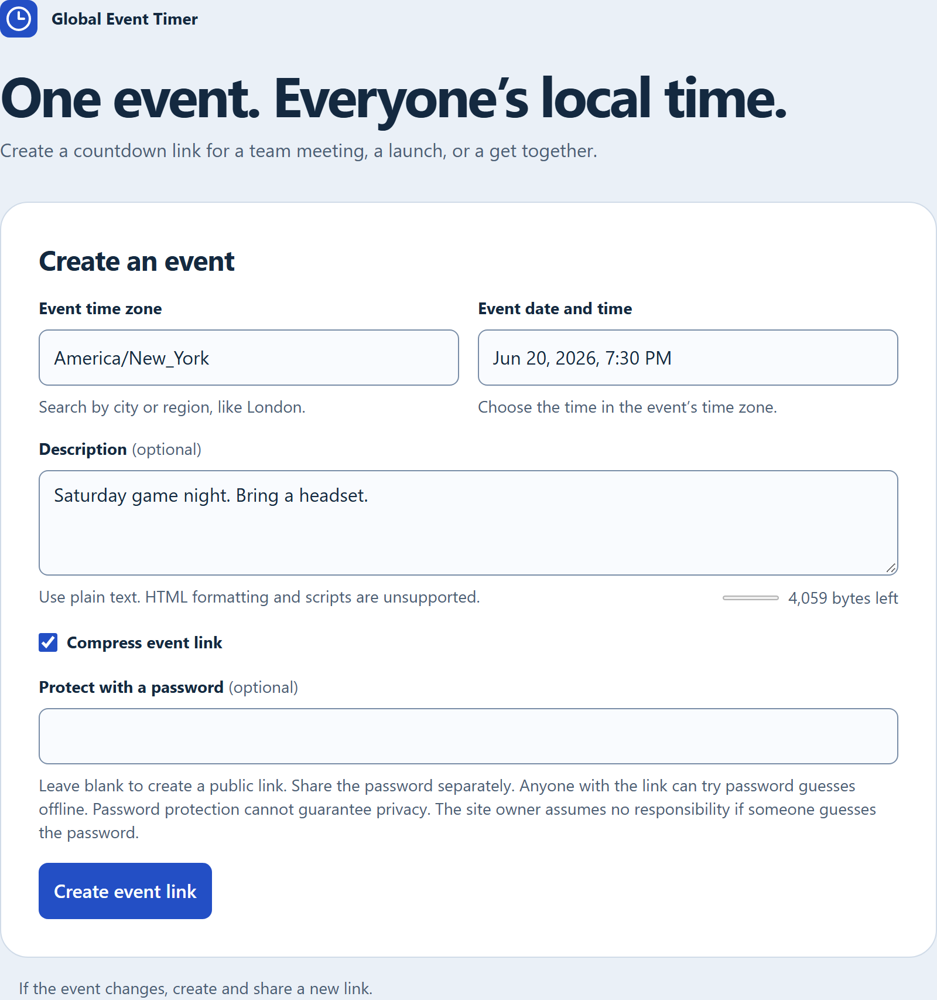
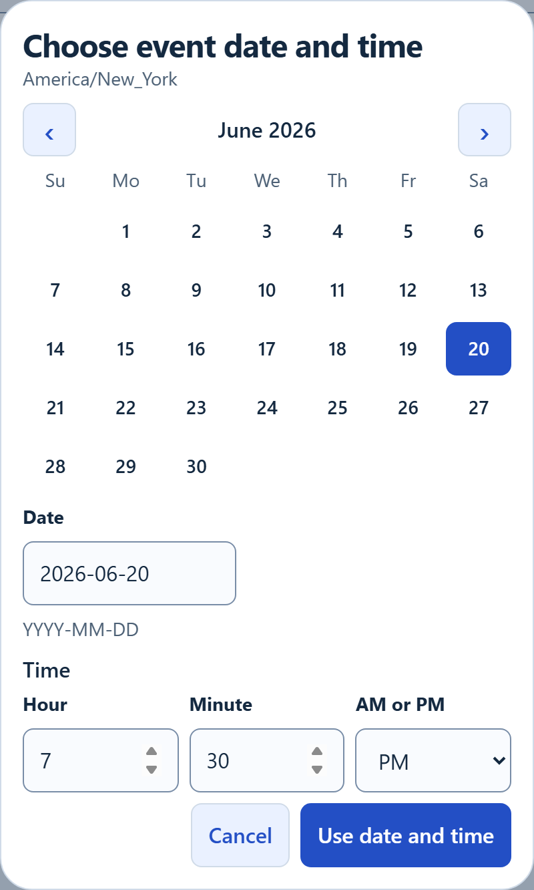
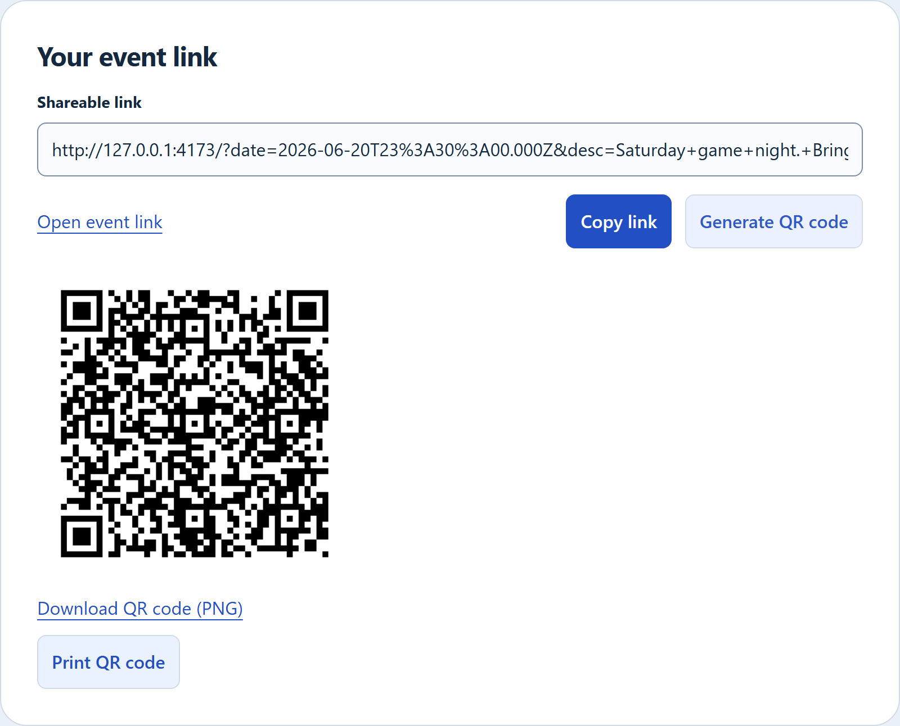
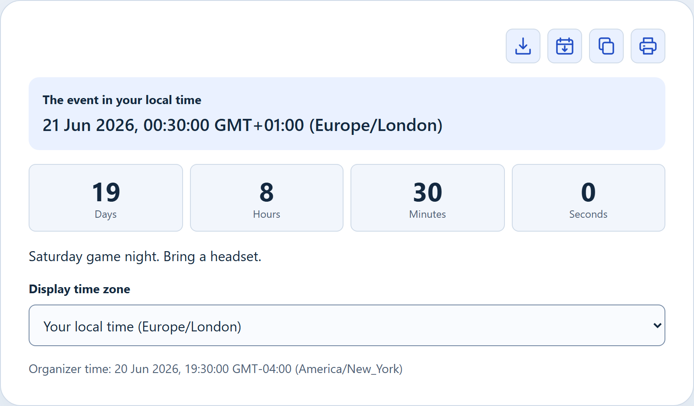

  

<h1 align="center">Tz Global Event Timer</h1>

<strong>One event. Everyone’s local time.</strong>

I play games with people all over the world. Picking a start time is the hard part. This site makes one link for the event. Each person who opens it sees that start time on their own clock, plus a countdown.

You can use it for a raid, a meeting, or a get-together. The time travels inside the link.

| Badge | Who it is for | What it tells you |
| --- | --- | --- |
| CI status | People changing the code | Tests on the `main` branch |
| Stack | People changing the code | The site is JavaScript, HTML, and CSS |
| Node.js 24+ | People changing the code | Node.js 24 or newer builds the site. The version in [`.nvmrc`](.nvmrc) is 26.13.1 |
| Static HTTPS | People putting the site online | Upload the built files to a normal website address that starts with `https://` |
| Links + QR codes | Anyone sharing an event | A shareable link and a scannable code |
| MIT | Anyone | You can use, change, and share the project. Keep the [license](LICENSE) with your copy |

---

## AI use

AI tools assisted with development and documentation for this project. The
timer runs in your browser without calling AI services.

---

## How a link works

The link stores one exact moment. Every phone and computer shows that same moment in its own time zone.

These pictures use one sample event: **June 20, 2026, at 7:30 PM in New York**. The countdown is frozen at June 1, so you can see the numbers sit still.

| Person | Time on their clock |
| --- | --- |
| Organizer in New York | June 20, 2026, 7:30 PM |
| Friend in London | June 21, 2026, 12:30 AM |
| Friend in Tokyo | June 21, 2026, 8:30 AM |

In June, London is five hours ahead of New York. So 7:30 PM in New York is 12:30 AM the next day in London. Tokyo is 13 hours ahead, so that same moment is 8:30 AM.

---

## See it

### You fill in the event

Type a city or a region, such as `London` or `New York`, or paste a time zone name such as `America/New_York`. Then pick the date and time **in that zone**.

### You pick the date and time

### You share the link

This sample was made on this computer, so the link starts with `127.0.0.1`. On your website, it starts with your site address.

### A friend in London opens it

The app follows the language on each computer. This London computer shows `00:30` in 24-hour time. That is 12:30 AM. The countdown still points at the New York time you picked.

---

## Make a link

1. Open the site.
2. Choose the **Event time zone**.
3. Choose the **Event date and time** in that zone.
4. Add a short **Description** if you want one. `Saturday game night` is enough.
5. Leave **Compress event link** checked. The site keeps the shorter link.
6. Click **Create event link**.
7. Click **Copy link**, or **Generate QR code** and send the picture.

A line under the button shows the time you saved, including how far that zone sits from the shared world clock (UTC). For this sample it reads `2026-06-20T19:30 UTC-04:00 (America/New_York)`. UTC−4 means four hours behind that shared clock.

If the plan changes, make a new link. Old links keep the old time.

---

## Ways to share

| Way | Use it when |
| --- | --- |
| **Copy link** | You are in chat, email, or Discord |
| **QR code** | You want a poster, a slide, or a stream overlay |

A normal invite fits in a QR code. A very long note might not. Shorten the note, or copy the link instead.

Leave secrets and sensitive information out of event links. Anyone with a public link can read the event details, and the link may appear in hosting logs.

Password protection is disabled by default because the legal implications of hosting it are unclear. Anyone who enables and hosts it takes responsibility for doing so.

When enabled, password protection reduces casual access. Anyone with the link can try guesses offline. Choose a long, randomly generated password or passphrase that you use only for that event. Send it through a separate channel. An intercepted or forwarded message can expose both the password and the link or QR code if you send them together. Knowing the password gives no assurance about who sent the link. After unlock, copied or downloaded text, calendar files, and printouts can expose the event details.

The full steps and limits are in [Using the timer](docs/using-the-timer.md).

---

## What people can do with the link

- Read the event in their own time zone.
- Switch **Display time zone** to look at another zone. The countdown still aims at the same moment.
- Copy the time, download it as text, or print it.
- Download a calendar file and add the event to a calendar app.
- Come back later. The countdown uses the clock on their device.

The page uses the time zone already set on the computer. An inaccurate device clock can make the countdown wrong. Confirm unexpected details and important times with the organizer through a contact method you already trust.

## Official addresses

- [taggedzi.github.io/tz-global-event-timer](https://taggedzi.github.io/tz-global-event-timer/)
- [timer.taggedz.me](https://timer.taggedz.me/)

The official Global Event Timer is available at the addresses listed here. Independent copies may handle event details and passwords differently. A modified site can read what you type before encrypting it or can collect details after unlock. If a site asks for a password, check its address before entering anything. Leave sensitive information out of event links.

Independent copies can look identical and can capture or publish event data. The [MIT license](LICENSE) allows people to modify and redistribute the software with the required notices. It provides the software as is and includes warranty and liability disclaimers. A lawful fork can operate independently. Report suspected impersonation under the relevant platform's policies.

The [timer on Matthew Craig’s personal domain](https://timer.taggedz.me/#official-addresses) lists the same addresses and links back here.

### Report abuse or a security bug

For abuse involving either official timer site, open a [GitHub issue](https://github.com/taggedzi/tz-global-event-timer/issues/new/choose) and choose **Question or other**. For suspected impersonation, use [GitHub’s abuse reporting process](https://docs.github.com/en/communities/maintaining-your-safety-on-github/reporting-abuse-or-spam) for GitHub-hosted content or report it to the relevant host.

Include the suspicious domain or address. Remove the query string (starting with `?`) and fragment (starting with `#`). Include redacted screenshots if helpful. Keep full event links, event details, and passwords out of public reports.

Use [private vulnerability reporting](https://github.com/taggedzi/tz-global-event-timer/security/advisories/new) for security bugs. See the [security policy](SECURITY.md) for what to include.

---

## When the clock jumps

Some places move the clock forward or back twice a year.

- If you pick an hour that never happens, because the clock jumped forward, pick a different time.
- If you pick an hour that happens twice, because the clock fell back, the site asks you which one you mean.

The preview line shows the choice you saved.

---

## More reading

Each guide is for one group. Start with the row that matches you.

| If you want to… | Read this |
| --- | --- |
| Create links, print QR codes, and save a calendar file | [Using the timer](docs/using-the-timer.md) |
| Put the site on the web, or download a release | [Hosting](docs/hosting.md) |
| Build a link by hand, or see how a link is stored | [Event links](docs/event-links.md) |
| Change the code and run the tests | [Contributing](CONTRIBUTING.md) |
| See how people are asked to behave here | [Code of conduct](CODE_OF_CONDUCT.md) |
| Report a security problem in private | [Security](SECURITY.md) |
| See how the calendar file is built | [Calendar export](docs/calendar-export.md) |

---

## License

Licensed under the [MIT License](LICENSE).

Created by Matthew Craig.
