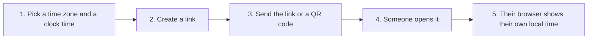
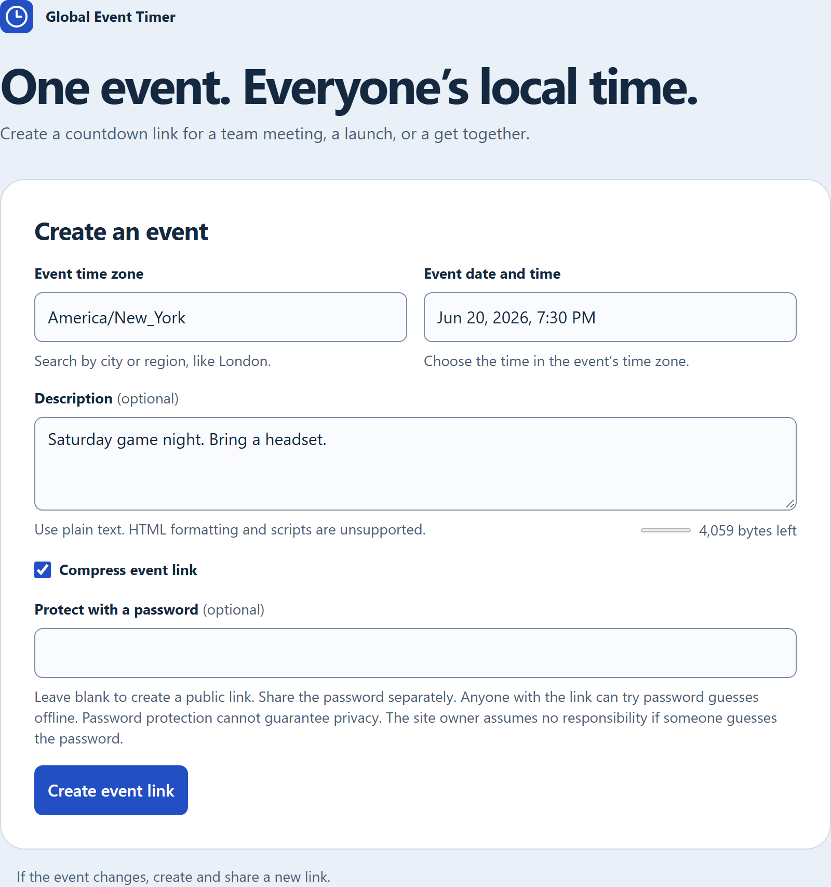
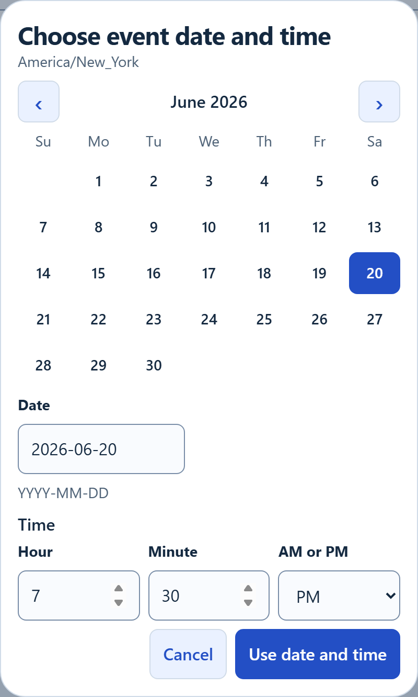
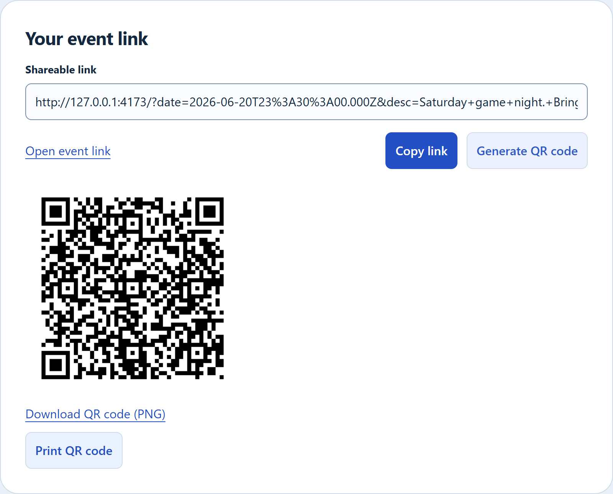
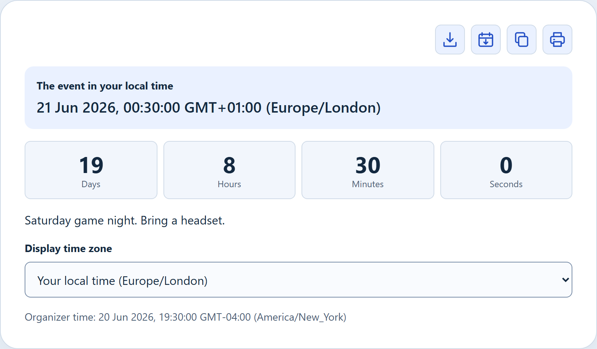
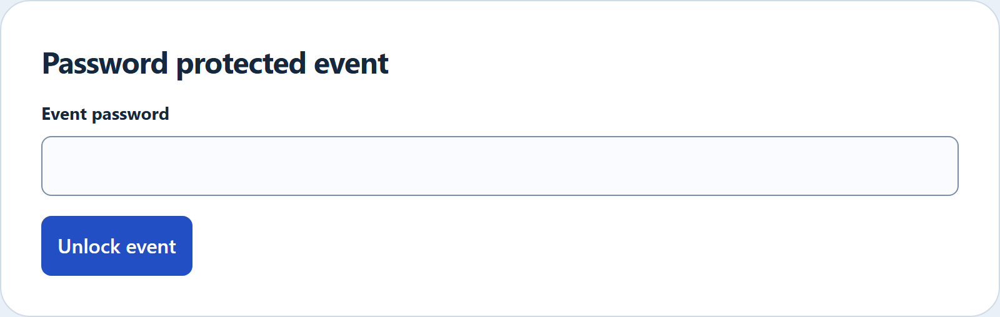

  

<h1 align="center">Tz Global Event Timer</h1>

<strong>One event. Everyone’s local time.</strong>

I play games with people all over the world. Picking a start time is the hard part. This site makes one link for the event. Each person who opens it sees that start time on their own clock, plus a countdown.

You can use it for a raid, a meeting, or a get-together. The time travels inside the link.

| Badge | Who it is for | What it tells you |
| --- | --- | --- |
| CI status | People changing the code | Tests on the `main` branch |
| Stack | People changing the code | The site is JavaScript, HTML, and CSS |
| Node.js 24+ | People changing the code | Node.js 24 or newer builds the site. The version in [`.nvmrc`](.nvmrc) is 26.13.1 |
| Static HTTPS | People putting the site online | Upload the built files to a normal website address that starts with `https://` |
| QR + passwords | Anyone sharing an event | A link, a scannable code, and an optional password |
| MIT | Anyone | You can use, change, and share the project. Keep the [license](LICENSE) with your copy |

---

## How a link works

The link stores one exact moment. Every phone and computer shows that same moment in its own time zone.

These pictures use one sample event: **June 20, 2026, at 7:30 PM in New York**. The countdown is frozen at June 1, so you can see the numbers sit still.

| Person | Time on their clock |
| --- | --- |
| Organizer in New York | June 20, 2026, 7:30 PM |
| Friend in London | June 21, 2026, 12:30 AM |
| Friend in Tokyo | June 21, 2026, 8:30 AM |

In June, London is five hours ahead of New York. So 7:30 PM in New York is 12:30 AM the next day in London. Tokyo is 13 hours ahead, so that same moment is 8:30 AM.

---

## See it

### You fill in the event

Type a city or a region, such as `London` or `New York`, or paste a time zone name such as `America/New_York`. Then pick the date and time **in that zone**.

### You pick the date and time

### You share the link

This sample was made on this computer, so the link starts with `127.0.0.1`. On your website, it starts with your site address.

### A friend in London opens it

The app follows the language on each computer. This London computer shows `00:30` in 24-hour time. That is 12:30 AM. The countdown still points at the New York time you picked.

---

## Make a link

1. Open the site.
2. Choose the **Event time zone**.
3. Choose the **Event date and time** in that zone.
4. Add a short **Description** if you want one. `Saturday game night` is enough.
5. Leave **Compress event link** checked. The site keeps the shorter link.
6. Click **Create event link**.
7. Click **Copy link**, or **Generate QR code** and send the picture.

A line under the button shows the time you saved, including how far that zone sits from the shared world clock (UTC). For this sample it reads `2026-06-20T19:30 UTC-04:00 (America/New_York)`. UTC−4 means four hours behind that shared clock.

If the plan changes, make a new link. Old links keep the old time.

---

## Three ways to share

| Way | Use it when |
| --- | --- |
| **Copy link** | You are in chat, email, or Discord |
| **QR code** | You want a poster, a slide, or a stream overlay |
| **Password** | You want the time and the note hidden until someone types a password |

Leave the password box empty for a public link. If you fill it in, send the password in a **different message** from the link. Anyone who has the link can try guesses on their own computer. A password cannot promise the event will stay private. If someone guesses it, the site owner is not responsible.

A normal invite fits in a QR code. A very long note might not. Shorten the note, or copy the link instead.

The full steps, limits, and warnings are in [Using the timer](docs/using-the-timer.md).

---

## What people can do with the link

- Read the event in their own time zone.
- Switch **Display time zone** to look at another zone. The countdown still aims at the same moment.
- Copy the time, download it as text, or print it.
- Download a calendar file and add the event to a calendar app.
- Come back later. The countdown uses the clock on their device.

The page uses the time zone already set on the computer.

---

## When the clock jumps

Some places move the clock forward or back twice a year.

- If you pick an hour that never happens, because the clock jumped forward, pick a different time.
- If you pick an hour that happens twice, because the clock fell back, the site asks you which one you mean.

The preview line shows the choice you saved.

---

## More reading

Each guide is for one group. Start with the row that matches you.

| If you want to… | Read this |
| --- | --- |
| Create links, use passwords, print QR codes, and save a calendar file | [Using the timer](docs/using-the-timer.md) |
| Put the site on the web, or download a release | [Hosting](docs/hosting.md) |
| Build a link by hand, or see how a link is stored | [Event links](docs/event-links.md) |
| Change the code and run the tests | [Contributing](CONTRIBUTING.md) |
| See how people are asked to behave here | [Code of conduct](CODE_OF_CONDUCT.md) |
| Report a security problem in private | [Security](SECURITY.md) |
| See how the calendar file is built | [Calendar export](docs/calendar-export.md) |

---

## License

Licensed under the [MIT License](LICENSE).

Created by Matthew Craig.
